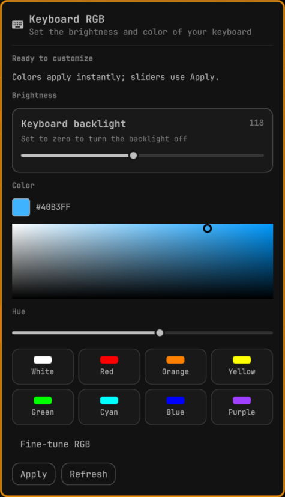

# Clevo RGB Keyboard for Omarchy

A community Omarchy bar widget for single-zone Clevo keyboard backlights.
Pick a color visually, select a preset, or fine-tune the RGB channels.



## Features

- Color picker with hue control and hex preview.
- Eight presets: white, red, orange, yellow, green, cyan, blue, and purple.
- Picker and presets apply immediately. Drag updates are throttled to about
  80 ms, with the latest selection retained while a write is in progress.
- Brightness and expandable RGB sliders, confirmed with **Apply**.
- System fonts, theme-aware styling, and a scrollable panel.
- Unprivileged LED helper with runtime checks for channel order and limits.

## Compatibility and requirements

Tested on **Clevo NH5xAx**, using **tuxedo-keyboard 3.2.10** and Omarchy kernel
**7.2.8-9-omarchy**. Other models have not been tested.

Requires Python 3, Omarchy's Quickshell-based shell with schemaVersion 1 and
`qs.Ui`, and an already working keyboard driver exposing:

```text
/sys/class/leds/rgb:kbd_backlight/
  brightness
  max_brightness
  multi_index
  multi_intensity
  multi_max_intensity
```

The helper requires exactly three channels named `red`, `green`, and `blue`,
in any order, and reads their individual maxima. This machine reports 255 for
all channels and brightness. Missing or unsupported attributes disable control;
the plugin does not install drivers or assume that every Clevo keyboard supports
multicolor sysfs. No per-key lighting, effects, or saved startup profiles.

## Install from GitHub

```sh
omarchy plugin add https://github.com/ainfarhanah/omarchy-clevo-rgb.git --enable
```

Then follow **Grant keyboard access** below. If you already installed a local
copy with the same plugin ID, back it up and remove it before installing from
GitHub; Omarchy will not overwrite an existing plugin with the same ID.

## Install from a local checkout

From the repository directory:

```sh
omarchy plugin validate .
mkdir -p ~/.config/omarchy/plugins/clevo.rgb
cp manifest.json Panel.qml led.py ~/.config/omarchy/plugins/clevo.rgb/
omarchy-shell shell rescanPlugins
omarchy plugin enable clevo.rgb --section right
```

If `clevo.rgb` is already installed, back it up before copying over its files.
Omarchy rejects plugin trees containing symlinks.

No marketplace listing is needed for installation by GitHub URL.

### Grant keyboard access

Review the files in `setup/`, then run from the repository directory:

```sh
sudo bash setup/install-permissions.sh "$USER"
```

For an installation made with `omarchy plugin add`, the same script is inside
`~/.config/omarchy/plugins/clevo.rgb/setup/`.

The installer creates the `clevo-rgb` group, adds your login, and installs
`/etc/udev/rules.d/70-clevo-rgb.rules`. Only that group gains write access to
this keyboard's brightness and RGB attributes. The panel and helper run as your
normal user, without sudo or a background privileged service.

**Reboot after setup** so the desktop and bar inherit the new group membership.
During testing, logging out and back in retained the old desktop groups.
Reboot persistence of the udev rule remains a release check; see [validation](VALIDATION.md).

## Use

Click the keyboard icon on the right side of the bar.

- **Picker / presets:** choose a color to apply it immediately.
- **Hue:** select the hue, then use the color field to choose saturation and
  intensity. At white or black, changing hue alone may have no visible effect.
- **Brightness:** adjust the slider, then select **Apply**.
- **Fine-tune RGB:** expand the individual sliders and select **Apply**.
- **Refresh:** read the keyboard's current settings, discarding unapplied edits.

Picker and preset writes include the currently displayed brightness, so a pending
brightness edit is also applied when selecting a color. Brightness 0 keeps the
light off while retaining the selected color. Opening the panel only reads state.
The color preview represents requested RGB values; actual LED appearance varies.

## Troubleshooting

Check the device and permissions as your normal user:

```sh
python3 ~/.config/omarchy/plugins/clevo.rgb/led.py state
id
```

`writable: false` means the current process cannot write the LED attributes.
Confirm that `id` includes `clevo-rgb` and reboot if the desktop still has old
groups. A missing attribute or unsupported layout means the installed driver
has not exposed the interface this plugin needs.

If installed QML edits do not appear after a rescan, use `omarchy restart shell`
in an unlocked session. Do this after the desktop has picked up the group change.

## Remove

Disable the widget first:

```sh
omarchy plugin disable clevo.rgb
omarchy plugin remove clevo.rgb
```

To also revoke keyboard access (affects everyone using this rule):

```sh
sudo rm -- /etc/udev/rules.d/70-clevo-rgb.rules
sudo gpasswd -d "$USER" clevo-rgb
sudo udevadm control --reload-rules
```

Reboot to restore the kernel's default attribute permissions and discard old
session group membership. The empty group can remain; remove it only if no
other user or tool needs it.

## Development checks

```sh
python3 -m unittest discover -s tests -v
omarchy plugin validate .
bash -n setup/install-permissions.sh
```

Tests use temporary fixtures and never touch hardware. They cover channel order,
invalid input rejection, per-channel limits, and missing multicolor support.
See [VALIDATION.md](VALIDATION.md) for hardware and UI testing details.

The helper accepts only `state` or `set BRIGHTNESS RED GREEN BLUE`, targets one
fixed LED device, and executes no shell commands. Both writable attributes are
opened before writing. Kernel writes are not transactional: an I/O failure after
the color write can leave a partially applied change; **Refresh** reads it back.

## License

[MIT](LICENSE) © 2026 Ain Farhana H.
